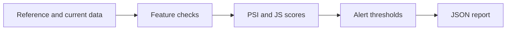

# Architecture and engineering decisions

> **Scope:** a local reference implementation using invented/synthetic inputs. No production deployment or service-level claims are implied.

## Reference-vs-current distribution monitoring

**Actual processing path:** Reference/current tabular samples --> Type and range checks --> Per-feature PSI / Jensen-Shannon comparison --> Threshold policy --> JSON alert report.

## Key files

- `driftwatch/metrics.py`: feature drift metrics, checks and alert thresholds.
- `driftwatch/__main__.py`: generated-data or CSV CLI path.

## Failure modes / trust boundaries

Distribution shift is not proof of degraded predictions. Thresholds are demos, not calibrated alerting policy. Data quality and concept drift need separate checks.

## What I would build next

Segment-level alerts, seasonal controls, monitor evaluation, model-performance joins and alert routing.

## Reviewer checklist

1. Read the source and confirm the processing path above.
2. Follow `docs/DEMO.md` and run the tests locally.
3. Inspect CI and document any divergence between local and GitHub results.
4. Treat all benchmarks as synthetic demonstrations unless proven otherwise.
